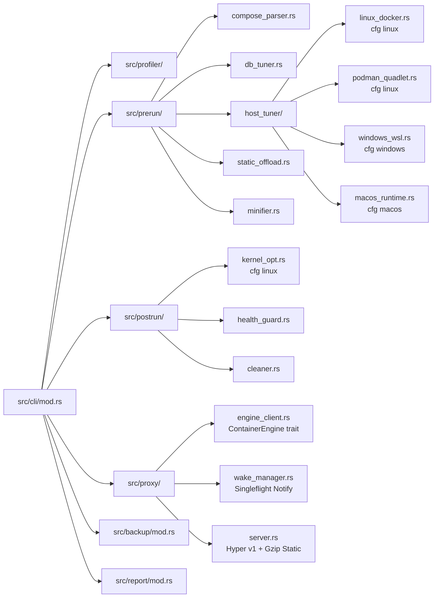

# LeanDock Technical Architecture

LeanDock is structured as a modular Rust binary + library crate (`leandock`) designed around **four execution phases** and a **cross-platform tiered capability model**.

## High-Level Module Map



## Phase Breakdown

### Phase 0: Pre-Flight Profiler (`src/profiler/`)
- `hardware.rs`: Uses `sysinfo` to collect CPU architecture (`x86_64` / `aarch64`), logical cores, total/available RAM, swap, and primary disk free space across Linux, Windows, and macOS.
- `platform.rs`: Evaluates `PlatformFacts` into a deterministic `CapabilityMatrix` across four tiers:
  - **Tier 1:** Compose & DB auto-tuner, container log rotation, safe cleanup.
  - **Tier 2:** Wake-on-Request reverse proxy & opt-in static offload.
  - **Tier 3:** OS-specific host runtime tuning (`daemon.json` on Linux, `.wslconfig` on Windows, VM advisor on macOS).
  - **Tier 4:** Linux kernel memory tuning (`zram`, `KSM` requiring kernel >= 6.1 and systemd >= 254, and Podman Quadlet).
- `runtime.rs`: Auto-discovers `docker compose` (v2), `docker-compose` (v1), `podman compose`, Unix sockets (`/var/run/docker.sock`, `$DOCKER_HOST`, Podman, OrbStack, Colima, Lima), and optional helpers (`podlet`, `slim`).

### Phase 1: Pre-Run Interceptor (`src/prerun/`)
- **Non-Destructive Override Strategy:** `compose_parser.rs` reads the original Compose file strictly read-only. `db_tuner.rs` computes an `OptimizationPlan` and renders `.leandock/compose.override.yml`. Compose merges both files via `<compose-cmd> -f <original> -f .leandock/compose.override.yml up -d`, guaranteeing original `${VAR:-default}` expressions, comments, and formatting remain untouched.
- **Transactional Host Backups (`src/backup/mod.rs`):** Every host file edit flows through `BackupSession::backup_and_write`, which copies the original file to `/var/lib/leandock/backups/<timestamp>/` (Linux root) or `~/.leandock/backups/<timestamp>/` (non-root/Windows/macOS), writes the new payload to a sibling temp file, and performs an atomic `rename()`.

### Phase 2: Post-Run Optimizer (`src/postrun/`)
- **Health Verification Guard (`health_guard.rs`):** Polls container status, restart count, exit code, and Docker healthcheck state over a configurable stability window (default 10s). On any crash-loop or non-zero exit, dumps the last 30 lines of logs and triggers automatic rollback to the unmodified original Compose file.
- **Safe Cleaner (`cleaner.rs`):** Runs *only after* `health_guard` confirms stability. Prunes strictly dangling `<none>` images and unused build cache — never `-a`, never volumes.

### Phase 3: Cross-Platform `ContainerEngine` Trait & Singleflight Proxy (`src/proxy/`)

To compile and run cleanly on Linux, macOS, and Windows without fragile Named Pipe Hyper hacks or heavy Docker SDKs, container lifecycle calls sit behind `#[async_trait] pub trait ContainerEngine`:

```rust
#[async_trait]
pub trait ContainerEngine: Send + Sync {
    async fn list_containers(&self) -> Result<Vec<ManagedContainer>>;
    async fn is_running(&self, container_id: &str) -> Result<bool>;
    async fn start_container(&self, container_id: &str) -> Result<()>;
    async fn stop_container(&self, container_id: &str) -> Result<()>;
}
```

- **Unix (`UnixSocketEngine`):** Connects directly over `tokio::net::UnixStream` + `hyper::client::conn::http1::handshake` to `/var/run/docker.sock`, Podman socket, or macOS OrbStack/Colima sockets.
- **Windows / Fallback (`CliContainerEngine`):** Uses `tokio::process::Command` wrapping `docker` / `podman` CLI seamlessly.

#### Wake-on-Request Singleflight State Machine (`wake_manager.rs`)

```mermaid
stateDiagram-v2
    [*] --> Sleeping
    Sleeping --> Waking: First request claims leadership<br/>calls engine.start_container()
    Waking --> Waking: Concurrent requests 2..N<br/>await Notify::notified()
    Waking --> Running: TCP probe succeeds<br/>notify_waiters() releases all N requests
    Waking --> Sleeping: wake_timeout expires<br/>notify_waiters() returns HTTP 503
    Running --> Sleeping: Idle reaper detects<br/>elapsed >= idle_timeout
```
